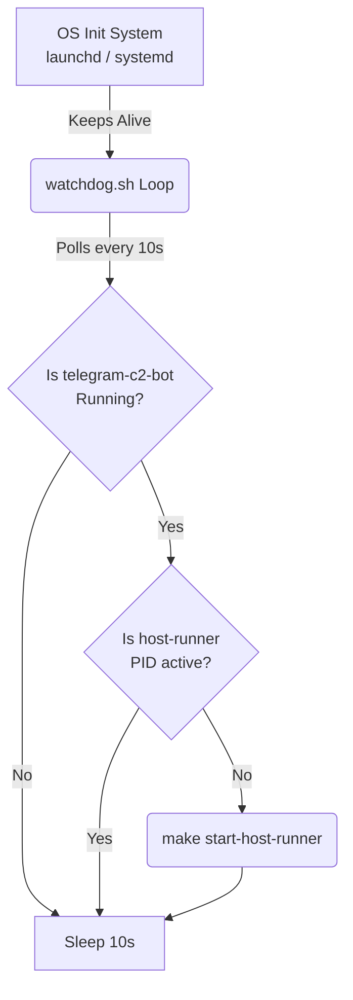

# Host Runner Watchdog Subsystem

## Overview

The Command and Control (C2) architecture decouples the Telegram bot interface from host-level execution. The `telegram-c2-bot` runs isolated inside a Docker container, while the `host-runner` process runs directly on the host operating system (macOS/Linux) to execute elevated or system-level tasks. 

Because Docker containers and host processes have independent lifecycles, this system implements an **OS-level Watchdog Pattern**. The watchdog script ensures the `host-runner` process strictly mirrors the uptime of the `telegram-c2-bot` container—automatically starting the runner if the bot goes online, and remaining idle when the bot is intentionally stopped.

## System Architecture



1. **State Polling:** The watchdog script (`scripts/watchdog.sh`) runs continuously in the background, polling Docker every 10 seconds.
2. **Auto-Healing:** If Docker Desktop starts slowly upon boot, or if the `host-runner` crashes, the watchdog detects the active container and instantly restarts the runner.
3. **Graceful Sleep:** If the container is intentionally spun down via `make down`, the watchdog detects the offline state and safely idles.

## Makefile Reference Guide

The `Makefile` serves as the primary control plane for both the Docker container and the host-runner service. 

| Command | Action | Description |
| :--- | :--- | :--- |
| `make install-watchdog` | **Setup** | Configures the OS to run the watchdog script automatically on boot via `launchd` (macOS) or `systemd` (Linux). Only needs to be run once per machine. |
| `make uninstall-watchdog` | **Teardown** | Removes the OS boot configuration and kills the background watchdog loop. |
| `make up` | **Lifecycle** | Builds and starts the `telegram-c2-bot` container and immediately starts the `host-runner`. |
| `make down` | **Lifecycle** | Stops the Docker container and kills the `host-runner` process. |
| `make restart` | **Lifecycle** | Executes `down` followed by `up`. |
| `make watchdog-logs` | **Telemetry** | Tails the background logs generated by `watchdog.sh`. |
| `make host-runner-logs` | **Telemetry** | Tails the application logs generated by the Python `host-runner` process. |
| `make status` | **Inspection** | Displays the Docker compose state alongside the PID and active configuration of the `host-runner`. |

## Operating System Persistence

To ensure the C2 bot survives system reboots and Docker Desktop initialization delays, the watchdog script is tied to the host's native service manager. The `Makefile` automatically detects your operating system and generates the correct configurations.

### macOS (launchd)
Running `make install-watchdog` generates a Property List (`.plist`) configuration at `~/Library/LaunchAgents/com.originfield.host-runner-watchdog.plist`. The service is bound to your user session and will launch the script as a daemon using macOS's standard `launchctl` utility.

### Linux (systemd)
Running `make install-watchdog` generates a user-level service unit at `~/.config/systemd/user/host-runner-watchdog.service`. It leverages `systemctl --user` to run the watchdog without requiring root/sudo privileges, ensuring the environment paths match the user's local `uv` and `docker` binaries.

## Operational Workflow

### Initial Deployment
When deploying to a new server or Mac host, run the following sequence to establish the persistent C2 pipeline:

```bash
# 1. Register the watchdog with the host OS
make install-watchdog

# 2. Build the configurations (if required by your stack)
make build-actions

# 3. Spin up the container and runner
make up
```

### Temporary Overrides
If you need to kill the `host-runner` but keep the Docker container active for debugging, you must first disable the watchdog to prevent it from auto-restarting the runner:

```bash
make uninstall-watchdog
make stop-host-runner
```

### Log Aggregation
Logs for the subsystem are segregated by concern. Use these commands to trace errors:
* **Container logic & Telegram API:** `make logs`
* **Host commands execution:** `make host-runner-logs`
* **Lifecycle & startup issues:** `make watchdog-logs`
